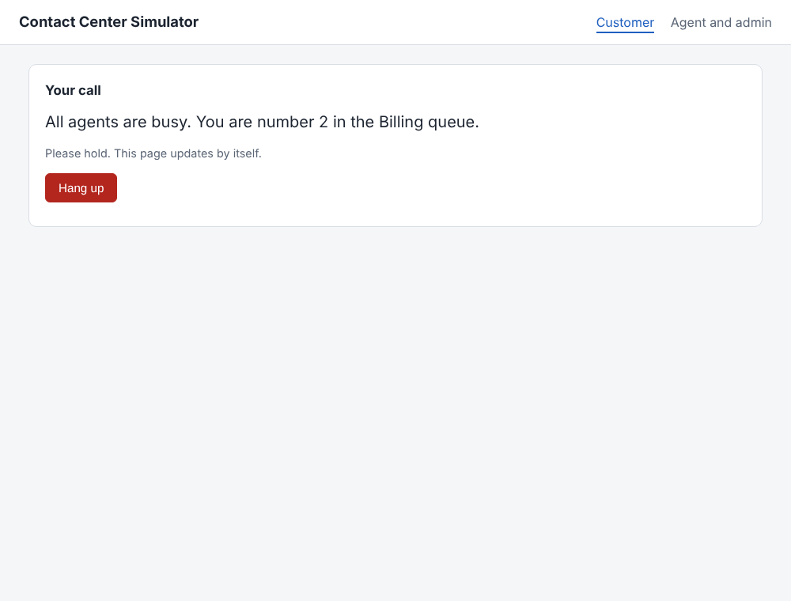
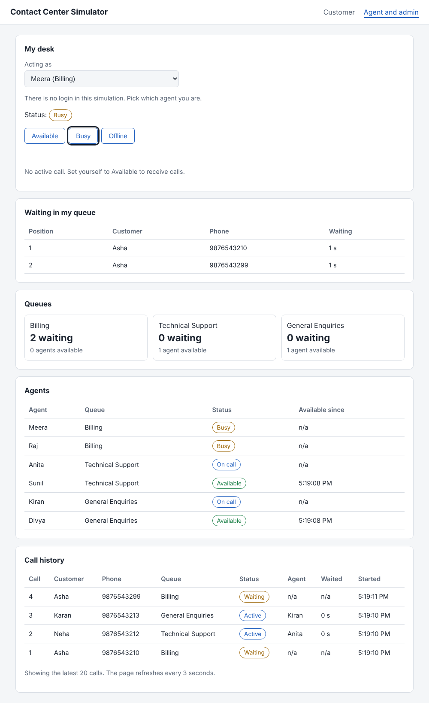
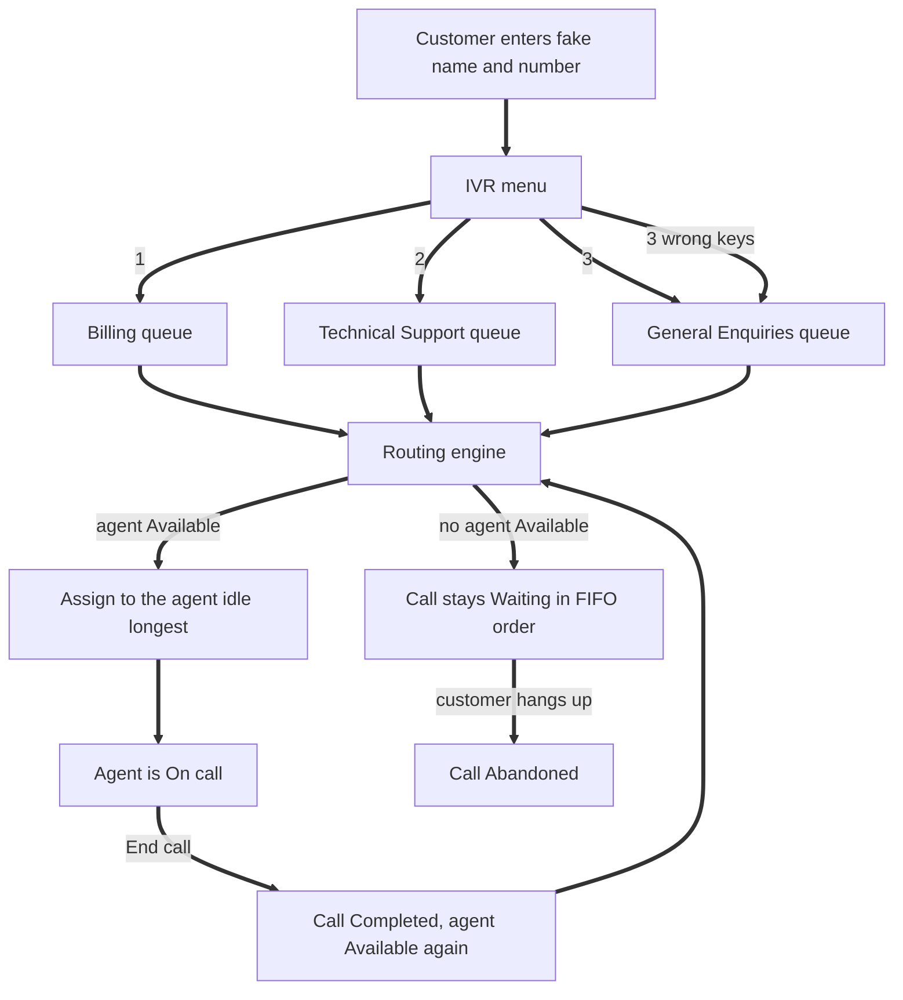

# Contact Center Simulator (IVR, routing and agent dashboard)

A small web application that simulates how a cloud contact center handles a call: a customer goes through an IVR menu, the system routes the call to the right queue, and an agent picks it up from a dashboard. It is built with HTML, CSS, JavaScript, Node.js and Express, and keeps all data in memory.

This is a simulation of contact center concepts. It does not configure or use real Amazon Connect resources.

## Screenshots

Customer page while the call waits in the Billing queue:



Agent and admin page:



## Run it

```
npm install
npm start
npm test
```

Open http://localhost:3000 for the customer page, and http://localhost:3000/agent.html in another tab for the agent and admin page.

## Try this demo

1. On the agent page, choose Meera and set her to Busy, then do the same for Raj. Billing now has no free agent.
2. On the customer page, enter a fake name and number, press 1 for Billing. The call waits and shows your queue position.
3. Back on the agent page, set Meera to Available. The waiting call is assigned to her automatically and her status becomes On call.
4. Press End call. She goes back to Available and the call shows as Completed in the history.
5. Try pressing 5, 7 and 9 in the menu. After three wrong keys the caller is sent to General Enquiries.

## How it works



### Routing rules

1. The customer picks a department only through the IVR menu (1 Billing, 2 Technical Support, 3 General Enquiries).
2. The system finds the queue for that department and the agents assigned to it.
3. Only agents with the Available status are eligible.
4. Among eligible agents, the one who has been Available the longest gets the call (longest idle first).
5. If nobody is eligible, the call stays in the queue. Waiting calls are served first in, first out.
6. Whenever an agent becomes Available or ends a call, the queue is checked again straight away.

### Agent statuses

| Status | Set by | Receives calls |
| --- | --- | --- |
| Available | The agent | Yes |
| On call | The system, when a call is assigned | No |
| Busy | The agent | No |
| Offline | The agent | No |

An agent who is On call cannot change their status by hand. They must end the call first.

### Call statuses

Waiting, then Active (assigned to an agent), then Completed (the agent ends it). A customer who hangs up while waiting is marked Abandoned.

### Two calls at the same time

Each state change (assigning a call, ending a call, changing a status) is one synchronous function. Node handles one request at a time, so two calls that arrive together cannot both take the same agent. This works because the state is in memory in one process. A real system with a database would need transactions or locks for the same guarantee.

## Project structure

| File | Purpose |
| --- | --- |
| `engine.js` | IVR logic, agents, queues, routing and call lifecycle. No web code. |
| `server.js` | Express server and JSON API |
| `public/index.html`, `customer.js` | Customer page: details, IVR keypad, live call status |
| `public/agent.html`, `agent.js` | Agent and admin page: status, current call, queues, agents, history |
| `test/engine.test.js` | 16 automated tests using Node's built in test runner |

### API

| Method and path | What it does |
| --- | --- |
| `GET /api/state` | Agents, calls and queue counts |
| `GET /api/calls/:id` | One call with its queue position |
| `POST /api/ivr` | One menu key press, returns retry or the department |
| `POST /api/calls` | Create a call |
| `POST /api/calls/:id/end` | Agent ends an active call |
| `POST /api/calls/:id/abandon` | Customer hangs up while waiting |
| `POST /api/agents/:id/status` | Set Available, Busy or Offline |
| `GET /api/metrics` | Queue depth, average wait, abandonment rate, call totals |
| `GET /health` | Simple check that the server is running |

## How it maps to Amazon Connect ideas

| This project | Amazon Connect concept |
| --- | --- |
| IVR menu and retry rule | Contact flow with a customer input block and an error branch |
| Department queues | Queues |
| Agents assigned to a queue | Routing profiles |
| Available, Busy, Offline, On call | Agent status |
| Longest idle first with FIFO queue | Routing inspired by contact center behaviour. It is not a copy of Amazon Connect's implementation. |
| Call history table | Contact records |

## Limits, on purpose

* No login. The agent page has a dropdown to choose who you are.
* Data is lost when the server restarts, and only the latest 200 calls are kept.
* The page refreshes every few seconds instead of using WebSockets.
* No real telephony and no real personal data. Use fake phone numbers.
* Customer details are shown with `textContent`, never as raw HTML.

## Next steps

* Admin override to reassign a call by hand
* Login for agents and a database for call history
* Overflow between queues after a long wait, and customer abandon timers
* Skill based routing
* Rebuild the same flow in a free Amazon Connect trial once billing is not a concern

## Notes

This project was developed as a hands-on implementation of core cloud contact center concepts. AI tools were used as development assistants for planning, implementation guidance, code review, and troubleshooting.

The routing logic, application behaviour, and design decisions were reviewed and tested throughout development.
